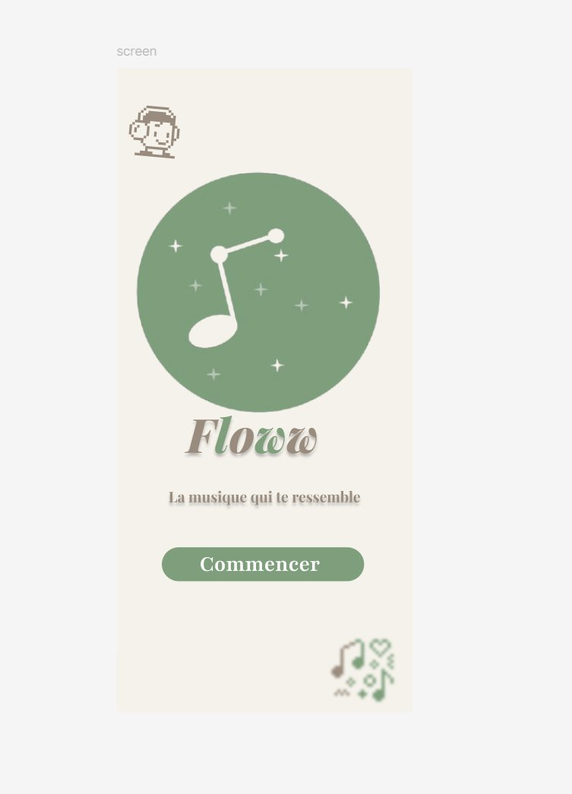
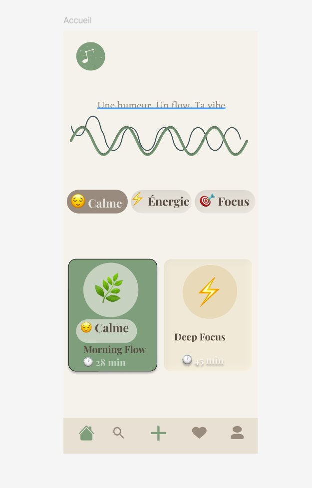
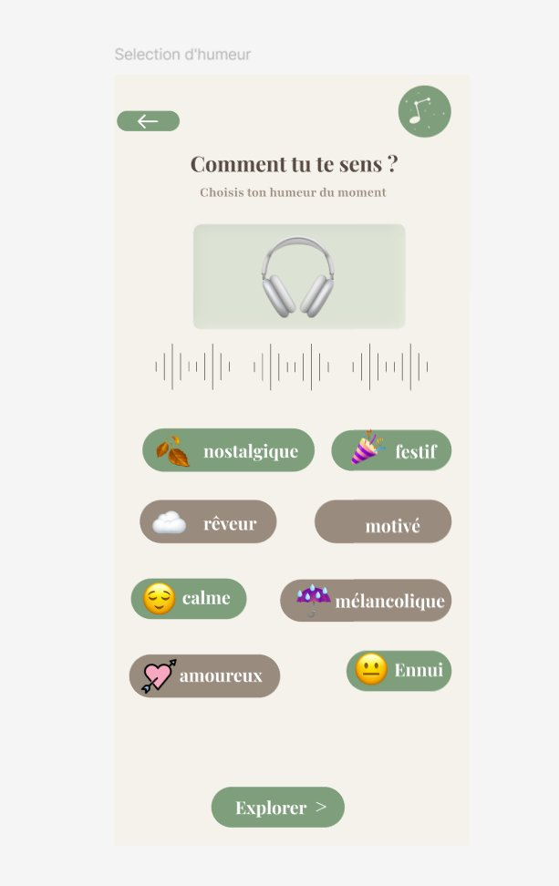
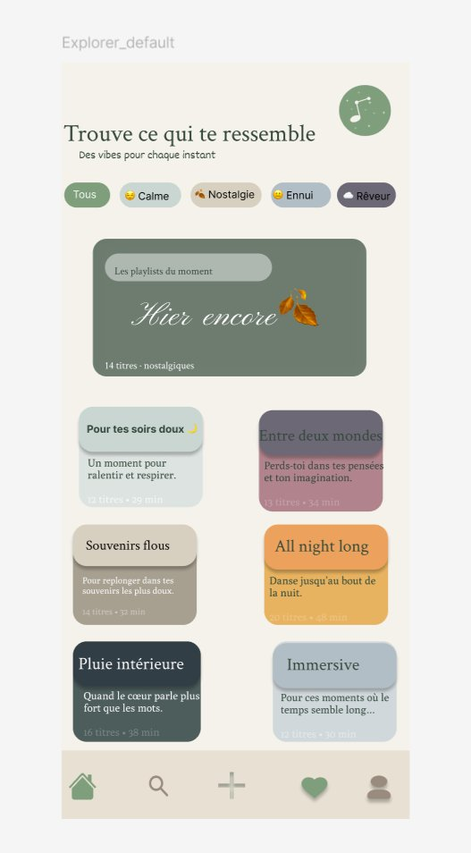
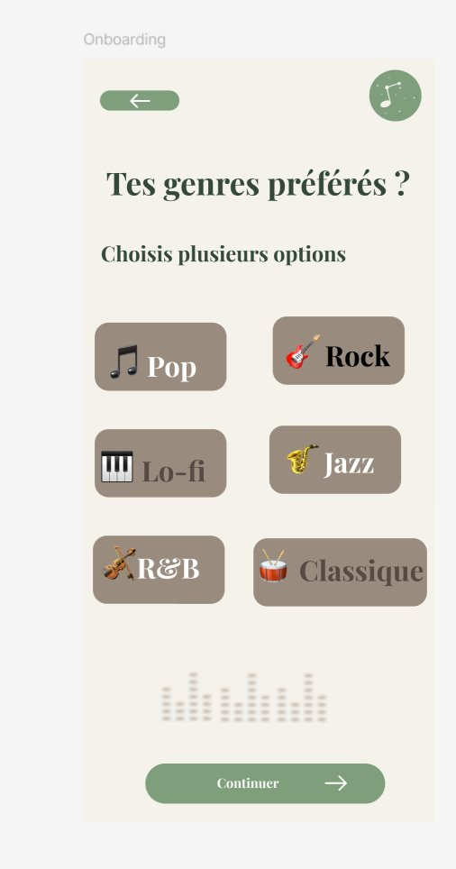
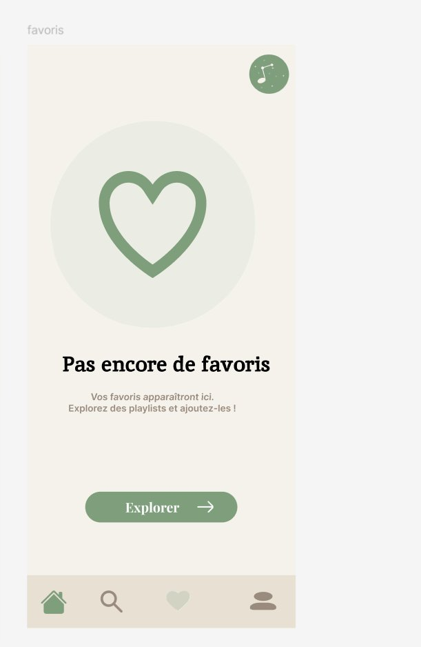

# 🎵 Floww

> **Une humeur. Un flow. Ta vibe.**
> Application mobile de bien-être numérique : la musique qui s'adapte à ton humeur.

Projet final UX/UI B2 · Conception d'un mini système d'interface  
**Auteure** : Hadiza Hamidou Ba

---

## 🔗 Liens

| | |
|---|---|
| 🎨 **Projet Figma** | [Ouvrir le projet](https://www.figma.com/design/oZQihj5edhnS2BH0u56tk7/Projet?node-id=0-1&p=f&t=Oe5rbo2ksU9zfYUR-0) |
| ▶️ **Prototype interactif** | [Ouvrir le prototype](https://www.figma.com/proto/oZQihj5edhnS2BH0u56tk7/Projet?node-id=52-5&p=f&t=yEGamjCM32wtYfg2-1&scaling=scale-down&content-scaling=fixed&page-id=0%3A1&starting-point-node-id=52%3A5) |

---

## 📂 Contenu du dossier `docs/`

| Fichier | Contenu |
|---|---|
| `Floww_Rapport.pdf` | **Rapport final** : projet, public cible, charte graphique, design system, prototype |
| `Note d'intention` | Intention du projet, besoin identifié, concept et structure de l'interface |
| `État de l'art` | Analyse des applications existantes et des tendances UX/UI |
| `Identité visuelle` | Recherches sur la palette, les typographies, le logo et les icônes |
| `Documentation du processus de conception` | Déroulé de la conception, du concept au prototype |

---

## 💡 Le projet

**Problème identifié** : on utilise tous la musique pour gérer nos émotions (se motiver, se calmer, se concentrer), mais les applications musicales classent leur contenu par genre ou par artiste, jamais par humeur vécue.

**Solution** : Floww part de l'utilisateur et non du catalogue. Au lieu de chercher une playlist, on répond à une question : *« Comment tu te sens ? »*. L'application propose ensuite des playlists adaptées.

**Type de service** : application mobile de bien-être numérique (Option 1 du brief).

---

## 👤 Public cible

**Profil** : 18-30 ans, étudiants et jeunes actifs, très connectés, qui écoutent de la musique au quotidien sur smartphone.

**Contexte d'usage** : trajets, pauses, sessions de travail, soirées, moments de décompression.

**Scénario d'usage**  
Après une journée chargée, Léa ouvre Floww dans le métro. L'écran de sélection lui demande comment elle se sent : elle choisit *mélancolique*. Elle découvre dans Explorer une playlist « Pluie intérieure », la lance et l'ajoute à ses favoris. En trois interactions, elle a la musique qui correspond à son état.

---

## 🔎 État de l'art

| Application | Approche | Limite par rapport à Floww |
|---|---|---|
| Spotify / Deezer / Apple Music | Catalogue, genres, recommandations par historique | L'humeur du moment n'est pas au centre du parcours |
| Calm / Headspace | Bien-être, méditation, sons apaisants | La musique n'y est qu'un outil secondaire |

**Positionnement de Floww** : à l'intersection de la musique et du bien-être, avec un parcours centré sur l'émotion.

---

## 🎨 Charte graphique

**Mots-clés** : douceur · organicité · fluidité

**Palette**

| Rôle | Couleur | Hex |
|---|---|---|
| Primaire | Vert sauge | `#7A9E7E` |
| Fond | Beige chaud | `#F5F0E8` |
| Fond composants | Blanc cassé | `#FDFAF4` |
| Texte / neutre | Brun profond | `#3B2F2F` |
| Secondaire | Vert sauge clair | `#C2D9C4` |

**Typographies**
- **Playfair Display** (serif) : titres, ton éditorial et chaleureux
- **Inter** (sans-serif) : textes courants et interface, pour la lisibilité

**Logo** : une note de musique blanche sur un cercle vert sauge, entourée d'étincelles. Réalisé sous Inkscape (SVG).

**Icônes** : bibliothèque Phosphor (via le plugin Iconify) : trait arrondi, cohérent avec l'identité douce.

**Élément signature** : l'onde musicale, présente sur plusieurs écrans comme fil conducteur.

---

## 🧩 Design system

**Grille et espacement** : unité de base de 8 px, marges latérales de 24 px, gouttières de 16 px, frame 390 × 844 px.

**Composants**

| Composant | États |
|---|---|
| Bouton primaire (pill, vert sauge) | Default · Hover · Disabled |
| Mood chip | Default · Hover · Actif |
| Carte playlist | Illustration ronde, titre, tag humeur, durée |
| Barre de navigation | Icône active en vert sauge, inactive en gris |

**Hiérarchie** : titre en serif → sous-titre → labels → métadonnées, avec des formes arrondies cohérentes sur tous les écrans.

---

## 📱 Les écrans

| # | Écran | Rôle |
|---|---|---|
| 1 | **Splash** | Logo, nom, tagline, bouton « Commencer » |
| 2 | **Onboarding** | Choix des genres musicaux préférés |
| 3 | **Accueil** | Humeur rapide (chips) et playlists suggérées |
| 4 | **Sélection d'humeur** | Choix de l'humeur parmi 8 états |
| 5 | **Explorer** | Playlists par ambiance, filtres par humeur |
| 6 | **Favoris** | État vide avec message d'accueil |








---

## 🧭 Parcours utilisateur

```
Splash → Onboarding → Accueil → Sélection d'humeur → Explorer
                         ↘ Favoris (via la barre de navigation)
```

La navigation entre écrans est fonctionnelle dans le prototype Figma, avec une barre de navigation commune.

---

## 🛠️ Outils

Figma · Inkscape · Iconify (Phosphor) · Google Fonts

---

*Projet réalisé dans le cadre du cours UX/UI B2.*# Floww
